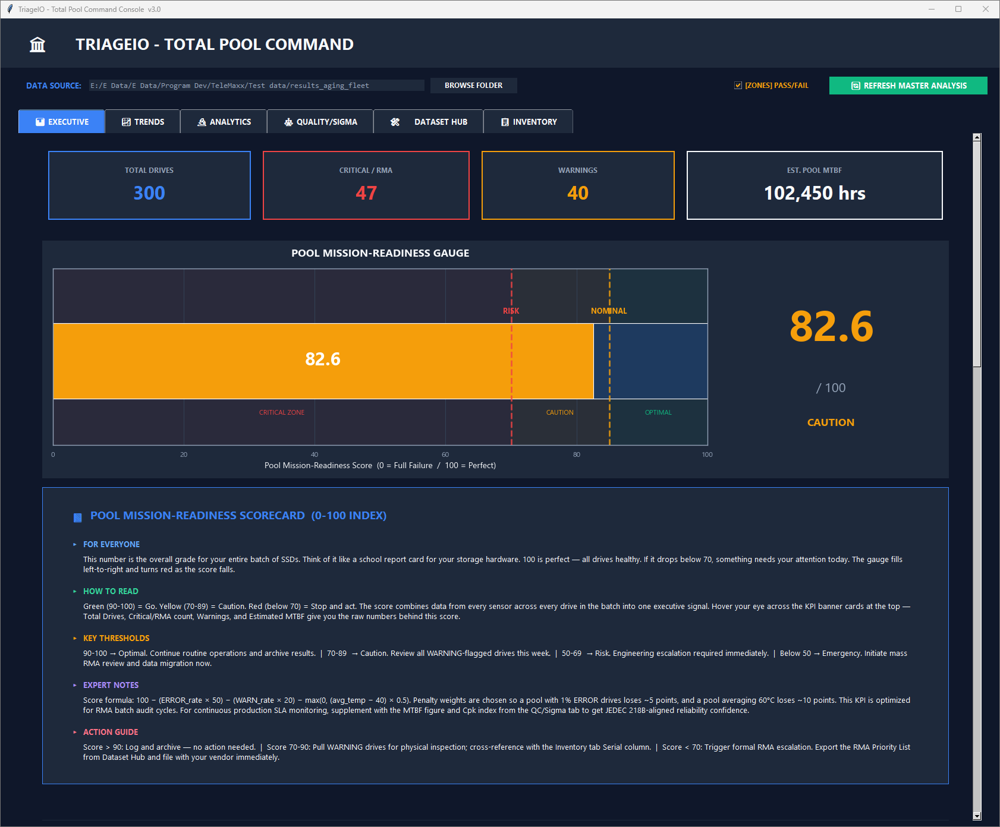

# TriageIO — Pool Telemetry Manager  v3.0

**Enterprise SSD telemetry ingestion, normalization, and fleet reliability analysis — desktop app for Windows.**



---

## Overview

TriageIO ingests vendor-specific SSD telemetry `.xlsx` exports, normalizes SMART field aliases across drive families, and renders a full pool-level telemetry management interface. The UI provides six analysis tabs covering executive health summaries, batch trends, statistical analytics, quality/sigma charts, a dataset export hub, and a per-drive inventory table.

---

## Quick Start

**Install dependencies:**

```bash
pip install -r requirements.txt
```

**Launch (GUI):**

```bash
python TriageIO.py
```

Or double-click `TriageIO.bat` — launches silently via `pythonw` with no terminal window.

---

## File Structure

```
TriageIO/
├── TriageIO.py                     # Desktop app entrypoint
├── TriageIO.bat                    # Windows silent launcher
├── requirements.txt
├── Test data/                      # 700 sample .xlsx files across all fixture trees
│   ├── results/                    # Primary 250-drive smoke-test fixture
│   ├── results_aging_fleet/        # 300-drive aging-fleet fixture
│   └── results_unstable_thermal/   # 150-drive unstable-thermal fixture
└── triageio/
    ├── desktop_app.py              # Full Tkinter UI, charts, exports
    ├── processor.py                # Telemetry ingestion & normalization
    ├── analyzer.py                 # Scoring, stats, anomaly/EOL/WAF, risk report
    └── main.py                     # Legacy CLI path (non-GUI)
```

---

## Input Data

`TelemetryProcessor` (`triageio/processor.py`) recursively scans a selected folder for `.xlsx` files and normalizes them into a canonical schema.

**Accepted formats:**
- Explicit `Metric` / `Value` columns
- Fallback: first two columns treated as metric/value

**Canonical fields resolved from vendor aliases:**

| Field | Examples of aliases resolved |
|---|---|
| `Temperature` | Temp, Celsius, Drive Temp |
| `Available Spare` | Spare%, Avail Spare |
| `Endurance Used` | % Used, PE Cycles Used, Endurance |
| `Media Errors` | Media Error Count, Uncorrectable |
| `Unsafe Shutdowns` | Unclean Shutdown, Unsafe Power Off |
| `Power On Hours` | POH, Hours On |
| `Data Units Written` | TBW, LBAs Written |
| `Error Log Entries` | Error Log Count |
| `Model`, `Serial`, `Firmware`, `Device` | |

**Status classification per drive:**

| Status | Condition |
|---|---|
| `ERROR` | Media Errors > 0, or Available Spare < 10% |
| `WARNING` | Available Spare < 90%, or Temp > 70°C, or Endurance Used > 90%, or Error Log Entries > 1000 |
| `OK` | All else |

---

## UI Tabs

### 1 — Executive

Fleet-level command view. Loaded on every refresh.

- **KPI banner** — Total Drives, Critical/RMA count, Warnings, Estimated Pool MTBF
- **Pool Mission-Readiness Gauge** — 0–100 composite score with CRITICAL / CAUTION / OPTIMAL zones
- **Reliability scatter** — Power On Hours vs Endurance Used with regression line; x-axis is data-focused, not padded by threshold spans
- **Health donut** — OK / WARNING / ERROR composition with percentage labels outside the ring
- Every chart ships a **5-section insight panel**: FOR EVERYONE / HOW TO READ / KEY THRESHOLDS / EXPERT NOTES / ACTION GUIDE

### 2 — Trends

Batch-over-batch line charts (`Batch_Idx` on x-axis):

- Temperature
- Available Spare
- Endurance Used
- Media Errors
- Unsafe Shutdowns
- Error Log Entries (log scale)

### 3 — Analytics

- Pearson correlation heatmap across all numeric fields
- Thermal KDE density by drive class
- Regression: Endurance Used vs Data Units Written
- Multi-sensor anomaly scatter (red stars on flagged drives)
- Predictive EOL bar chart — top 25 most at-risk drives
- WAF proxy boxplot by drive class

### 4 — Quality / Sigma

- Shewhart I-Chart (temperature) with mean and ±3σ control lines
- Cpk histogram vs 70°C USL
- Failure mode Pareto chart
- Available spare violin plot by drive class
- Firmware revision maturity — stacked OK/WARNING/ERROR per revision

### 5 — Dataset Hub

Central operations panel:

- **Batch stats banner** — files found, parsed, skipped/corrupt, pool score, RMA count, anomaly count, MTBF
- **Parse error preview** — first N corrupt/unreadable entries
- **Pool aggregation summary** table
- **Export center** — one-click exports (see Exports section)
- **Failure risk analysis** — findings grouped by engineering domain with risk level (CRITICAL / HIGH / WARNING / INFO / PASS), detail, recommendation, and standards reference
- **Engineering reference standards** cards

### 6 — Inventory

Full sortable drive-level table: model, serial, firmware, all health metrics, and status flag per drive.

---

## Toolbar

**`[ZONES] PASS/FAIL` toggle** — overlays enterprise pass/fail threshold bands and lines across all applicable charts:

- Temperature
- Available Spare
- Endurance Used
- Media Errors
- Unsafe Shutdowns
- Error Log Entries
- Power On Hours

---

## Analytics Engine

`TelemetryAnalyzer` (`triageio/analyzer.py`) provides:

- `calculate_fleet_score()` — composite 0–100 pool health index
- `get_cpk(column, usl)` — process capability index
- `identify_rma_candidates()` — drives meeting ERROR criteria
- `get_pareto_data()` — failure mode frequency breakdown
- `detect_anomalies(threshold=3.0)` — z-score multi-sensor flagging
- `predict_eol()` — estimated end-of-life per drive
- `calculate_waf()` — write amplification factor proxy
- `get_fleet_percentiles()` — p25/p50/p75/p95 across key fields
- `get_aggregation_summary()` — per-model/class summary stats
- `generate_risk_report()` — structured findings by engineering domain
- `estimate_mtbf()` — pool-level mean time between failures

---

## Exports

All exports from **Dataset Hub**:

| Export | Format |
|---|---|
| Full Pool Data | CSV |
| RMA Priority List | CSV |
| Anomaly Report | CSV |
| Pool Stats Summary | CSV |
| Multi-sheet workbook | Excel (Pool Data, RMA Priority List, Aggregations, Anomaly Report, EOL Predictions, Percentiles) |
| Full structured export | JSON (metadata + percentiles + aggregations + anomalies + EOL + full pool) |

---

## Test Data

Sample telemetry `.xlsx` files are included under `Test data/results/` — 700 drives spanning four drive classes:

| Class | Example |
|---|---|
| Consumer HighPerf 4TB | `PD0_Consumer_HighPerf_4TB_...` |
| ENT NVMe Gen4 3.84TB | `PD18_ENT_NVMe_Gen4_3.84TB_...` |
| ENT NVMe Gen5 7.68TB | `PD1_ENT_NVMe_Gen5_7.68TB_...` |
| ENT SATA QLC 30.72TB | `PD3_ENT_SATA_QLC_30.72TB_...` |

Point the app at the `Test data/results/` folder to load the full sample pool immediately.

---

## Legacy CLI

`triageio/main.py` is a non-GUI CLI path retained for automation. The desktop app is the primary supported interface.

```bash
python -m triageio.main --results-dir <telemetry_path>
```

Options:
- `--results-dir` — folder containing exported `.xlsx` files
- `--output-csv` — destination path for `rma_analysis_report.csv`
- `--rma-only` — print only ERROR-status drives

---

## Dependencies

```
pandas
numpy
openpyxl
tabulate
matplotlib
seaborn
```

Python standard library: `tkinter`, `os`, `sys`, `ctypes`
